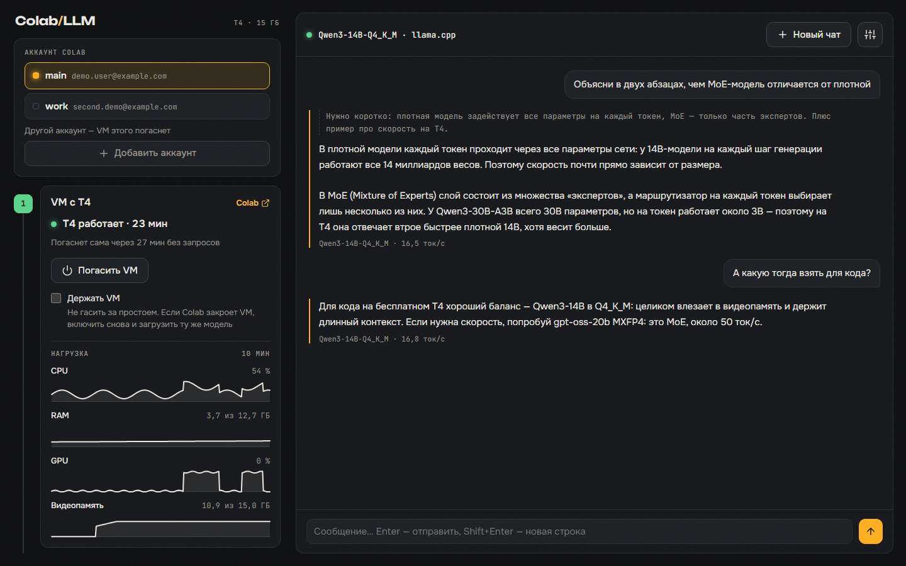
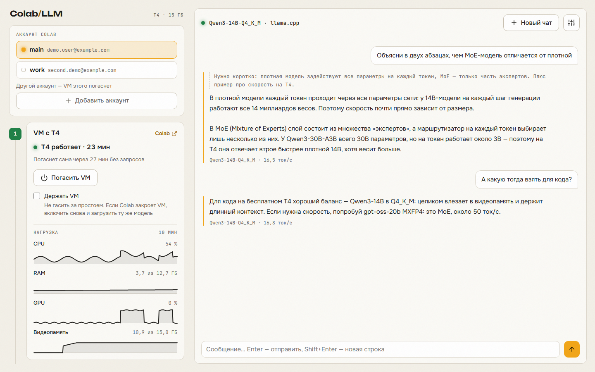
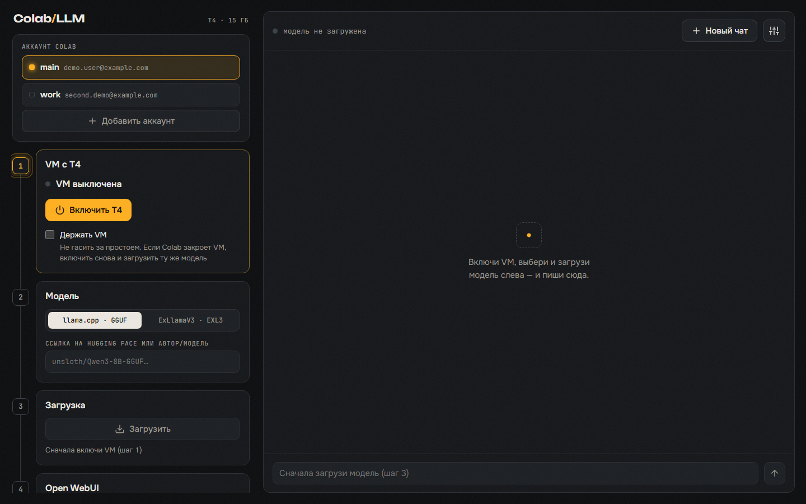
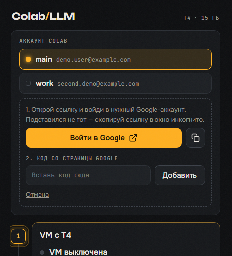
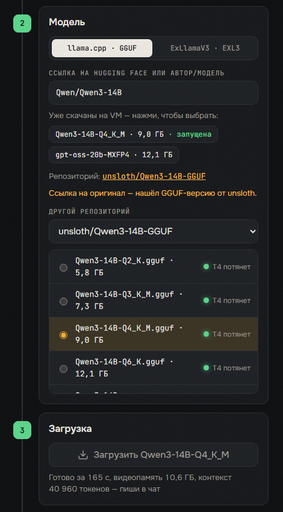
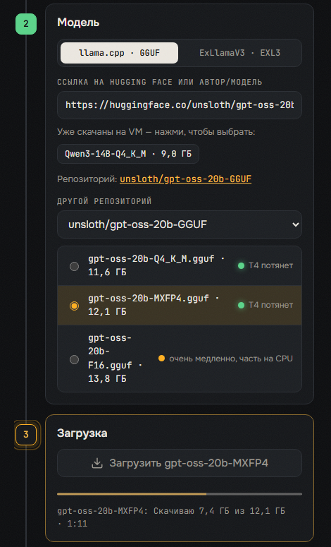
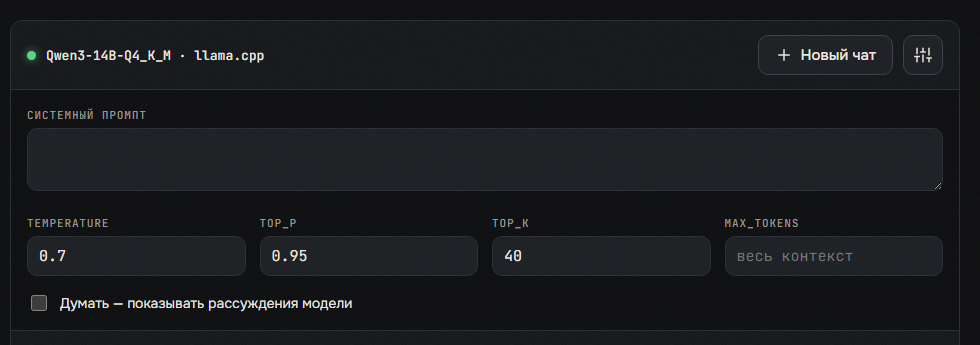
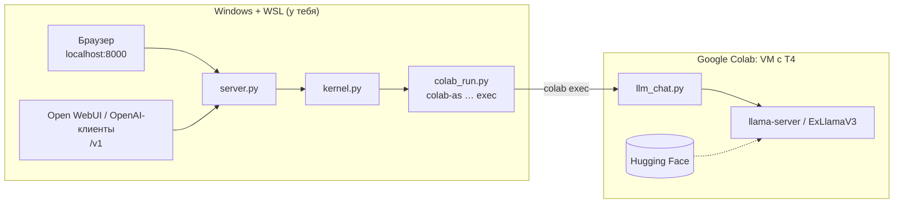

# Colab LLM — свои модели на бесплатном Colab T4

Локальная панель, которая поднимает LLM-чат и генерацию картинок на **бесплатной видеокарте T4 в Google Colab**.
Вставляешь ссылку на модель с Hugging Face → страница сама подбирает формат и квантование под 15 ГБ видеопамяти → через пару минут можно общаться в чате или подключить Open WebUI как к обычному OpenAI API.



<details>
<summary>Светлая тема</summary>


</details>

**Что умеет**

- Один клик — VM с T4 в Colab, без браузера и ноутбуков. VM сама гаснет после 30 минут простоя, чтобы не тратить квоту.
- Модели с Hugging Face в двух форматах: **GGUF** (llama.cpp) и **EXL3** (ExLlamaV3). По ссылке на оригинал страница сама находит квантованную версию и помечает, какие варианты T4 потянет.
- Чат со стримингом, рассуждениями модели (`<think>`), системным промптом и параметрами генерации.
- **OpenAI-совместимый API** `http://localhost:8000/v1` для Open WebUI и любых OpenAI-клиентов: стриминг, `usage`, вызов инструментов.
- Несколько Google-аккаунтов: переключение в один клик.
- Графики CPU, RAM, GPU и видеопамяти VM за последние 10 минут.
- Картинки через ComfyUI: SD 1.5, SDXL и Z-Image-Turbo прямо из терминала.
- Работает через официальный [Colab CLI](https://github.com/googlecolab/google-colab-cli) и `colab exec`, без SSH и туннелей, которые бесплатный Colab запрещает.

> Скриншоты в README сняты на демо-данных: аккаунты `@example.com` выдуманные.

---

## Содержание

- [Что нужно](#что-нужно)
- [Быстрый старт](#быстрый-старт)
- [Установка](#установка)
- [Как пользоваться](#как-пользоваться)
- [Какие модели потянет T4](#какие-модели-потянет-t4)
- [Open WebUI и OpenAI API](#open-webui-и-openai-api)
- [Картинки (ComfyUI)](#картинки-comfyui)
- [Закончить работу](#закончить-работу)
- [Аккаунты, токены и приватность](#аккаунты-токены-и-приватность)
- [Проверки](#проверки)
- [Устройство проекта](#устройство-проекта)
- [Правила бесплатного Colab](#правила-бесплатного-colab)

## Что нужно

- **Windows 10 (2004+) или Windows 11.** Всё работает внутри WSL 2 с Ubuntu: Colab CLI не поддерживает Windows. Установщик поставит WSL и Ubuntu сам.
- Включённая **аппаратная виртуализация** в BIOS. Обычно она уже включена, иначе установщик подскажет, как её включить.
- **Google-аккаунт** с доступом к Colab. Подойдёт бесплатный.
- *(необязательно)* **Токен Hugging Face**: нужен только для закрытых моделей (gated), например Llama. Взять его можно на [huggingface.co/settings/tokens](https://huggingface.co/settings/tokens), хватит прав `Read`.

На Linux и macOS тоже заработает, если поставить `python3`, [uv](https://docs.astral.sh/uv/) и Colab CLI вручную (см. [Установка](#установка) → «Вручную»).

## Быстрый старт

1. Скачай проект: **Code → Download ZIP** на этой странице и распакуй куда угодно. Или:
   ```powershell
   git clone https://github.com/hitrax-user/collab-for-ai.git
   ```
2. Дважды кликни **`install.cmd`** в папке проекта. Если Windows покажет «Windows защитила ваш компьютер», нажми «Подробнее» → «Выполнить в любом случае».
3. В открывшемся меню нажми **`+`** и войди в Google-аккаунт. Потом нажми номер аккаунта: в браузере откроется `http://localhost:8000`.
4. На странице: **«Включить T4»** → вставь, например, `Qwen/Qwen3-14B` → **«Загрузить»** → пиши в чат.

Дальше запускай через ярлык **«Colab LLM»** на рабочем столе.

## Установка

### Автоматически (Windows)

Двойной клик по `install.cmd`. Скрипт:

- проверяет версию Windows и аппаратную виртуализацию;
- ставит WSL 2, если его нет. Windows попросит права администратора. Если нужна перезагрузка, скрипт предложит её и сам продолжит установку после входа в Windows;
- ставит Ubuntu, если её нет, и заводит пользователя Linux с тем же именем, что в Windows;
- ставит в Ubuntu `python3`, [uv](https://docs.astral.sh/uv/) и Colab CLI;
- кладёт на рабочий стол ярлык «Colab LLM» и сразу запускает меню.

Повторный запуск безопасен: то, что уже стоит, пропускается. Если WSL не запускается и после перезагрузки, скрипт объяснит, как включить виртуализацию в BIOS.

### Вручную

Если WSL с Ubuntu уже есть (или ты на Linux или macOS):

```bash
curl -LsSf https://astral.sh/uv/install.sh | sh   # если uv ещё нет
uv tool install google-colab-cli
cd <папка проекта>
./menu
```

Из Windows открыть папку проекта в WSL можно так: `wsl -d Ubuntu --cd <папка проекта>` (подойдёт и путь Windows).

## Как пользоваться

### Меню в терминале

```bash
./menu
```

При первом запуске меню спросит HF-токен: Enter пропускает этот шаг. Потом меню покажет аккаунты, их email и есть ли у них VM:

```
Colab LLM
  1) main · demo.user@example.com · T4 работает
  2) work · second.demo@example.com · VM нет
  +) Добавить аккаунт
  q) Выход
```

- **`+`**: добавить аккаунт. Меню напечатает ссылку для входа: открой её, выбери Google-аккаунт и вставь код в терминал. Если браузер подставляет не тот аккаунт, открой ссылку в режиме инкогнито. Имя аккаунта берётся из email.
- **Номер аккаунта**: запустить сервер и открыть страницу `http://localhost:8000`. **Ctrl-C** возвращает в меню. Если VM ещё работает, меню спросит, погасить ли её (Enter — погасить).

### Страница управления

Слева шаги сверху вниз, справа чат. Текущий шаг подсвечен янтарным, пройденные — зелёным.



#### Аккаунт

Список аккаунтов вверху. Переключиться можно одним кликом, но только пока VM не загружает модель. Если VM включена, переключение её погасит.

Чтобы добавить аккаунт прямо со страницы, нажми **«Добавить аккаунт»** → **«Войти в Google»**, войди в нужный аккаунт и вставь код со страницы Google в поле. Если VM выключена, страница сразу переключится на новый аккаунт.



#### Шаг 1. VM с T4

- **«Включить T4»** создаёт VM и заливает на неё HF-токен. Статус обновляется сам.
- Через **30 минут без запросов** VM гаснет сама. **«Погасить VM»** гасит её сразу.
- Галочка **«Держать VM»** отключает авто-стоп. Если Colab сам закроет VM, сервер включит её снова и загрузит последнюю модель. Если T4 не выдали, следующая попытка будет через 5 минут.
- **«Нагрузка»**: CPU, RAM, GPU и видеопамять за 10 минут. Наведи курсор на график, чтобы увидеть значение в тот момент.
- **«Colab ↗»** открывает ту же сессию в обычном интерфейсе Colab.

#### Шаг 2. Модель

Вставь ссылку на Hugging Face или `автор/модель`, и страница сама определит формат:

- **GGUF** запускается через llama.cpp, **EXL3** — через ExLlamaV3. Переключатель движка меняется сам.
- По ссылке на оригинал или другой формат (AWQ, GPTQ, EXL2) страница найдёт подходящую версию: для GGUF сначала `unsloth/…`, для EXL3 — `turboderp/…`, иначе самую скачиваемую. Другой репозиторий можно выбрать в списке.
- У каждого варианта есть метка: 🟢 **«T4 потянет»**, 🟡 **«очень медленно, часть на CPU»** или 🔴 **«не влезет»**. По умолчанию выбран самый крупный вариант, который T4 потянет.
- Ссылка на конкретный файл или ветку (`/blob/main/x.gguf`, `/tree/3.0bpw`) выбирает именно его.
- Модели, уже скачанные на эту VM, показаны кнопками: клик выбирает модель.



#### Шаг 3. Загрузка

**«Загрузить»** ставит движок, качает модель (прогресс и таймер видны прямо в карточке) и прогревает её. Новая модель выгружает предыдущую.



После загрузки под кнопкой видны время загрузки, занятая видеопамять и контекст. Если часть слоёв не влезла в GPU, появится жёлтое предупреждение: скорость упадёт в разы, лучше взять квант поменьше.

<details>
<summary>Подробности: контекст, слои и прогрев</summary>

- Контекст у GGUF подбирает llama.cpp: самый длинный, на котором модель обучена и который ещё целиком влезает в видеопамять, но не меньше 8192 токенов. Малые модели получают десятки тысяч токенов, крупные 27B остаются на 8192. У EXL3 контекст всегда 8192.
- Сколько слоёв положить на GPU, llama.cpp решает сам. Ему помогают флаги `-fa on -ctk q8_0 -ctv q8_0` (KV-кэш в q8_0 вдвое меньше почти без потери качества) и `-fitt 256` (запас видеопамяти 256 МиБ вместо 1 ГиБ, на T4 это ещё 3–4 слоя крупной модели).
- Самый долгий этап у llama.cpp — прогрев: при первом запросе он компилирует ядра CUDA под T4. Для 27B IQ2_M это около 2 минут. Скомпилированные ядра живут до конца VM, поэтому следующая модель с тем же квантованием прогревается быстрее.
</details>

#### Чат

Ответ появляется по мере генерации, под ним видны модель и скорость. История хранится в браузере и не пропадает при перезагрузке страницы, **«Новый чат»** её очищает.

Кнопка **⚙** открывает настройки: системный промпт, `temperature`, `top_p`, `top_k`, `max_tokens` и галочку **«Думать»**. С ней рассуждения модели идут серым над ответом. Пустой `max_tokens` значит, что ответу отдан весь остаток контекста. Если ответ упёрся в лимит, под ним жёлтым видно, что он обрезан и почему.



> Каждое сообщение — отдельный `colab exec`, поэтому до первого токена проходит 3–5 с, а запросы выполняются по одному. Модели живут, пока жива VM: на новой VM их придётся скачать заново.

Если код сервера обновился, пока он работал, страница покажет красную плашку. Перезапусти сервер (Ctrl-C и снова номер аккаунта в меню).

## Какие модели потянет T4

На бесплатной VM 15 ГБ видеопамяти и 12 ГБ RAM. Главное — размер файла, а не число параметров:

- **GGUF до ~12,5 ГБ** целиком помещается в видеопамять и работает быстро. **12,5–16 ГБ** запустится, но часть слоёв уйдёт на CPU, и скорость упадёт. **Больше 16 ГБ** не влезет.
- **EXL3** должен целиком поместиться в видеопамять: примерно до 13,5 ГБ.
- **MoE-модели** (`A3B` в названии, gpt-oss) быстрые даже при большом размере: на каждый токен работает малая часть параметров. Плотные 27B на T4 медленные на любом движке.
- Модель из нескольких файлов (`-00001-of-…`) показывается одним вариантом с общим размером. `mtp-*.gguf` и `mmproj` — не модели, страница их не показывает.

Замеры на бесплатном T4. «Готова за» включает установку движка и скачивание, «Скорость» — генерацию ответа:

| Модель | Движок | Файл | Готова за | Скорость |
|---|---|---|---|---|
| Qwen3-0.6B Q8_0 | llama.cpp | 0,64 ГБ | 51 с | 111 ток/с |
| Qwen3-0.6B BF16 | llama.cpp | 1,2 ГБ | 111 с | 97 ток/с |
| Qwen3-0.6B 4.0bpw | ExLlamaV3 | — | — | 159 ток/с |
| Qwen3-4B Q8_0 | llama.cpp | 4,3 ГБ | 63 с | 43 ток/с |
| Qwen3.5-9B (DavidAU) Q4_K_M | llama.cpp | 6,8 ГБ | 230 с | 28 ток/с |
| Qwen3-14B Q4_K_M | llama.cpp | 9,0 ГБ | 165 с | 16,5 ток/с |
| Qwen3.8-27B IQ2_M (noMTP) | llama.cpp | 10,2 ГБ | 232 с | 9,1 ток/с |
| Qwen3.8-27B IQ4_XS (noMTP), на GPU 63 из 65 слоёв | llama.cpp | 15,1 ГБ | 333 с | 5,8 ток/с |
| gpt-oss-20b MXFP4 | llama.cpp | 12,1 ГБ | 256 с | 49,5 ток/с |
| Qwen3-30B-A3B 3.0bpw | ExLlamaV3 | 12,2 ГБ | 335 с | 48,3 ток/с |

**С чего начать:** `Qwen/Qwen3-14B` — хороший универсал, `unsloth/gpt-oss-20b-GGUF` — самый быстрый из крупных.

## Open WebUI и OpenAI API

Тот же сервер отдаёт API `http://localhost:8000/v1`: `/models` и `/chat/completions`, со стримингом и без. Модель всегда называется `colab`, а в отображаемом имени видна загруженная, например «Colab · Qwen3-14B-Q4_K_M». Ключ не нужен.

```bash
curl http://localhost:8000/v1/chat/completions \
  -H "Content-Type: application/json" \
  -d '{"model": "colab", "messages": [{"role": "user", "content": "Привет!"}]}'
```

Сервер слушает только `127.0.0.1`, но Open WebUI в Docker Desktop достаёт его по `host.docker.internal`.

**Подключение Open WebUI** (один раз):

1. Admin → Settings → Connections → OpenAI API → «+». URL: `http://host.docker.internal:8000/v1`, ключ — любой, например `colab`.
2. Admin → Settings → Interface → Task Model: выбери другую модель или выключи генерацию заголовков, тегов, follow-up и автодополнение. Иначе каждая фоновая задача Open WebUI будет вставать в очередь к Colab.

Что учесть:

- `temperature`, `top_p`, `top_k`, `max_tokens` и другие параметры доходят до модели, `n` игнорируется. Без `max_tokens` модель пишет до конца контекста. Обрезанный ответ приходит с `finish_reason: "length"`.
- `usage` считает сама модель. В потоке `usage` приходит в последнем кадре, а с `stream_options.include_usage` — отдельным кадром без `choices`, как у OpenAI.
- **Инструменты** работают у моделей llama.cpp: `tools` и `tool_choice` доходят до модели, вызов приходит полем `tool_calls` с `finish_reason: "tool_calls"`. У EXL3 инструментов нет.
- Рассуждения приходят внутри ответа в `<think>…</think>`. Включить их из клиента: `"chat_template_kwargs": {"enable_thinking": true}`.
- Пока модель не загружена, API отвечает 503. Переключать модель можно только на странице.

## Картинки (ComfyUI)

ComfyUI без интерфейса на отдельной VM, промпты пишутся прямо в терминале:

```bash
./colab-as main new -s comfy --gpu T4
./colab-as main upload -s comfy ~/.cache/huggingface/token /content/.hf_token   # если токена нет — пропусти
./colab-as main exec -s comfy -f comfy_start.py --timeout 1800                  # установка и запуск, около 2 мин
./draw
```

После `[sdxl]>` пиши промпт, лучше по-английски. Картинка появится в `out/`. `/sd15`, `/sdxl` и `/zimage` переключают модель, Ctrl-D выходит. Модель скачивается при первой картинке с ней. Аккаунт и сессию можно передать аргументами: `./draw sdxl main comfy`.


| Модель | Скачать | Картинка | Первая / следующие |
|---|---|---|---|
| `sd15` — SD 1.5 | 2,1 ГБ, 19 с | 512px | 10 с |
| `sdxl` — SDXL base | 6,9 ГБ, 67 с | 1024px | 50 с |
| `zimage` — Z-Image-Turbo | 21 ГБ, ~8 мин | 1024px | 113 с / 54 с |

## Закончить работу

Простаивающая VM тратит бесплатную квоту.

- **LLM-VM** гаснет при выходе со страницы (Ctrl-C в терминале, потом Enter на вопросе), сама через 30 минут без запросов (если не стоит «Держать VM») или по кнопке «Погасить VM».
- **VM для картинок** гаси руками:

```bash
./colab-as main stop -s comfy
./colab-as main sessions        # должно быть «No active sessions»
```

## Аккаунты, токены и приватность

**В репозитории нет ни аккаунтов, ни токенов.** Всё личное хранится только у тебя в WSL:

| Что | Где |
|---|---|
| Вход в Google, сессии, email аккаунта | `~/.colab-accounts/<аккаунт>/` |
| HF-токен (один на все аккаунты) | `~/.cache/huggingface/token` |
| Галочка «Держать VM» | `~/.colab-keep` |
| История чата на странице | localStorage браузера |

- `./colab-as <аккаунт> <команда colab>` выполняет любую команду Colab CLI от имени нужного аккаунта: у каждого аккаунта свой `HOME` в `~/.colab-accounts/<аккаунт>`.
- HF-токен заливается на каждую новую VM файлом через `colab upload`, поэтому не попадает в логи CLI. На VM он исчезает вместе с VM.
- Делишься проектом? Передай папку без `out/` и `__pycache__/`: личного в ней нет.

> ⚠️ FAQ Colab запрещает несколько аккаунтов ради обхода лимитов, а санкции могут затронуть все связанные аккаунты.

### История и логи Colab CLI

CLI сохраняет всё, что выполнялось на VM, вместе с выводом: код, твои сообщения и ответы модели. Это попадает в `~/.colab-accounts/<аккаунт>/.config/colab-cli/history/*.jsonl`, а отладочный лог — в `colab.log` там же. Выключить это нельзя. Удалить историю всех аккаунтов:

```bash
rm -f ~/.colab-accounts/*/.config/colab-cli/history/*.jsonl ~/.colab-accounts/*/.config/colab-cli/colab.log
```

`token.json`, `sessions.json`, `settings.json` и `email` не трогай: в них вход, активные сессии и имя аккаунта в меню.

## Проверки

Обе проверки идут без сети, VM и GPU:

```bash
python3 test_server.py   # разбор ссылок HF и вариантов моделей
python3 test_kernel.py   # ядро VM: состояние, чат, ошибки, очередь, повтор при обрыве связи
```

В `test_kernel.py` настоящий `llm_chat.py` выполняется в словаре вместо ядра VM, а вместо llama-server отвечает фейк на порту 8181. Загрузку модели так не проверить: ей нужен GPU.

Смоук-тест VM, GPU и скачивания с HF:

```bash
./colab-as main new -s smoke --gpu T4
./colab-as main upload -s smoke ~/.cache/huggingface/token /content/.hf_token
./colab-as main exec -s smoke -f llm_smoke.py --timeout 600
./colab-as main stop -s smoke
```

Если T4 не выдали (ошибка 400 на `new`), убери `--gpu T4`: тест пройдёт и на CPU.

## Устройство проекта



| Файл | Что делает |
|---|---|
| `install.cmd`, `install.ps1` | установка WSL, Ubuntu, uv, Colab CLI и ярлыка на рабочем столе |
| `menu` | меню в терминале: аккаунты, запуск страницы |
| `server.py` | локальный HTTP-сервер: страница, `/api/*` и OpenAI-совместимый `/v1` |
| `index.html` | страница управления (один файл, без сборки) |
| `kernel.py` | «ядро VM»: состояние, очередь запросов и чат поверх `colab exec` |
| `llm_chat.py` | код, который выполняется на VM: ставит движок, качает и запускает модель |
| `colab_run.py` | транспорт: выполнение кода в ядре VM через `./colab-as … exec` |
| `colab-as` | Colab CLI от имени нужного аккаунта |
| `comfy_start.py`, `draw` | ComfyUI на VM и генерация картинок из терминала |
| `llm_smoke.py`, `test_*.py` | смоук-тест VM и офлайн-тесты |

Термины проекта собраны в [GLOSSARY.md](GLOSSARY.md).

## Правила бесплатного Colab

- **Нельзя:** SSH (хотя в CLI есть `colab ssh`), туннели и веб-интерфейсы, запущенные на VM. Поэтому страница, API и картинки работают у тебя локально, а в VM ходят через `colab exec`.
- **Нельзя:** торренты и P2P. Модели скачиваются на VM прямо с Hugging Face.
- **Нельзя:** дипфейки, то есть реальные люди в сгенерированном контенте.
- **Если Colab предупредит о запрещённом коде или оборвёт рантайм,** остановись и не обходи проверку.
